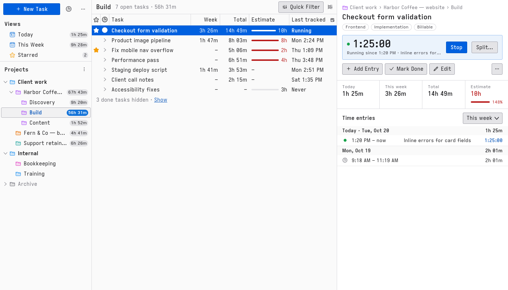

# Time Tracker for Thunderbird

Track time on projects and tasks in a Thunderbird tab of their own, laid out like the mail tab:
a project tree on the left, the task list in the middle, task details and time entries on the
right.



- Nested projects with colours, time badges rolled up from every subproject, and Today,
  This Week and Starred views.
- Tasks with estimates, tags, notes and a billable flag. Done tasks are hidden until you want them.
- One running timer: start, stop, switch or split it from a task row, the details pane, the toolbar
  popup or a keyboard shortcut. It keeps running across restarts.
- Time entries from the timer or added by hand, edited, split, and deleted with undo.
- JSON backup and restore, CSV export of time entries.
- Light and dark themes, three densities, keyboard and screen reader support, English and French.

Your data stays in your Thunderbird profile. The add-on makes no network requests
([PRIVACY.md](PRIVACY.md)).

## Install

Requires **Thunderbird 157** or later.

1. Download `time-tracker-<version>.xpi` from the
   [latest release](https://github.com/a-mango/thunderbird-time-tracker/releases/latest).
2. In Thunderbird: **≡ → Add-ons and Themes**, the gear icon, **Install Add-on From File…**, and
   choose the file.
3. Click the stopwatch in the spaces toolbar (left edge) to open Time Tracker.

## Keyboard

Shortcuts follow Thunderbird where it has an equivalent. In the tab:

| Keys                          | Where                                 | Action                                                 |
| ----------------------------- | ------------------------------------- | ------------------------------------------------------ |
| `Alt+Shift+K`                 | anywhere in Thunderbird               | Stop the running timer, or start the task tracked last |
| `Alt+Shift+O`                 | anywhere in Thunderbird               | Open the Time Tracker popup                            |
| `Ctrl+N`                      | tab                                   | New task in the selected project                       |
| `Ctrl+Shift+N`                | tab                                   | New project                                            |
| `Ctrl+E`                      | tab                                   | Add a time entry to the selected task                  |
| `Ctrl+Shift+K`                | tab                                   | Quick filter: show it and focus the text field         |
| `Tab` / `Shift+Tab`           | tab                                   | Move between the panes and controls                    |
| `↑` `↓` `Home` `End`          | trees, task list, time entries        | Move the selection                                     |
| `←` `→`                       | project tree                          | Collapse or expand, go to the parent or first child    |
| Letters                       | trees                                 | Type-ahead: select the next row starting with them     |
| `PageUp` / `PageDown`         | task list                             | Move a page                                            |
| `Enter`                       | project tree                          | Select the project                                     |
| `Enter`                       | task list, time entries               | Open the properties or entry dialog                    |
| `Space`                       | task list                             | Start or stop the task's timer                         |
| `S`                           | task list                             | Star or unstar                                         |
| `F2`                          | project tree, task list               | Rename                                                 |
| `Delete`                      | project tree, task list, time entries | Delete (tasks and entries can be undone)               |
| `Shift+F10` or the Menu key   | rows                                  | Context menu                                           |
| `Esc`                         | quick filter text                     | Clear the text                                         |
| `↓` or `Enter`                | quick filter text                     | Go to the task list                                    |
| `←` `→` `Home` `End`          | pane splitters, column edges          | Resize                                                 |
| `Enter` / `Esc`               | dialogs                               | Confirm / cancel                                       |
| `↑` `↓` `Home` `End`, `Enter` | popup                                 | Choose a task and start it                             |

`Alt+Shift+K` and `Alt+Shift+O` can be changed in **Add-ons and Themes → gear → Manage Extension
Shortcuts**.

## Build from source

The add-on ships its source as-is: `npm run build` only zips `src/` (no bundling, minifying or
transpiling), so the XPI is the reviewable source.

Tested build environment:

- OS: Fedora Linux 44 (any OS with Node.js works)
- Node.js **22.23.1** (also in `.nvmrc`) and the npm it comes with (**10.9.8**)
- Git

On a fresh machine:

```sh
git clone https://github.com/a-mango/thunderbird-time-tracker.git
cd thunderbird-time-tracker
git checkout v0.1.0-beta.1 # the release you want to rebuild
npm ci                     # dev tools only, from package-lock.json; nothing goes into the XPI
npm run build              # → dist/time-tracker-0.1.0.xpi
```

`npm run build` runs `web-ext build --source-dir src`, leaving out the type declarations in
`src/types/`.

## Development

| Command           | What it does                                                                       |
| ----------------- | ---------------------------------------------------------------------------------- |
| `npm run dev`     | Serve `src/` at http://localhost:5173/ with a mock `messenger` and fictional data  |
| `npm run check`   | Lint, type check, unit tests, `web-ext lint`                                       |
| `npm run test:ui` | Playwright UI tests (Firefox)                                                      |
| `npm run shots`   | Screenshots of the dev harness into `artifacts/shots/`                             |
| `npm run tb`      | Thunderbird with an isolated dev profile (`.tb-profile/`) and the extension loaded |
| `npm run tb:rc`   | Fresh profile (`.tb-rc/<version>/`) with the built XPI installed                   |

Dev harness options: `?seed=N` re-seeds, `?fixtures=empty` starts empty, `?fixtures=large` loads
50,000 entries, `?locale=fr` shows French, `?density=compact|relaxed`.

Design and scope live in [docs/](docs/): `SPEC.md`, `DESIGN.md`, `PLAN.md`. Releases follow
[docs/RELEASE.md](docs/RELEASE.md).

## Licence and credits

Time Tracker is licensed under the [Mozilla Public License 2.0](LICENSE).

Icons in `src/ui/icons/` and the design token values come from Thunderbird (also MPL 2.0); see
[THIRD_PARTY.md](THIRD_PARTY.md). The extension icon is original artwork. Changes are listed in
[CHANGELOG.md](CHANGELOG.md).
